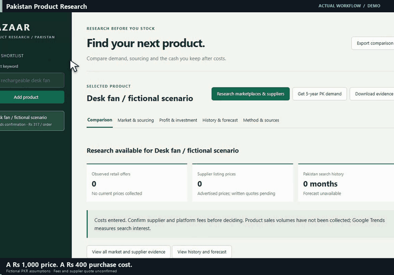

# Pakistan Product Research

Local Flask app for comparing public marketplace evidence, supplier quotes, PKR order economics, return losses, cash requirements, and monthly forecasts. Google Trends interest stays distinct from sales. Actual sales history must come from a seller export.

## Run

Create a virtual environment, install `requirements.txt`, then run `python app.py`. The app listens on loopback; review the URL printed by the app. On Windows, `setup.ps1` and `start.ps1` provide launch helpers. `python -m unittest test_app -v` checks economics, collection rules, and the local API with isolated temporary databases.

No seller database or commercial history is included. The demo calculates a fictional scenario with unverified fee and purchase-cost assumptions. Its numbers are outputs of this code, not investment advice or actual business results.

Search can use separately installed OpenSERP or DDGS. `LEAD_FINDER_ROOT` and `OPENSERP_URL` configure the optional native search backend. Flask, NumPy, DDGS and trendspyg remain separate dependencies.

## Demo

The demo records actual local interactions with fictional inputs. Cursor movement, camera zooms and captions are added for readability. See CREDITS.md for the exact recording setup.

## Source references

See [Credits and source references](CREDITS.md) for the upstream tools, libraries and fonts used, and details of the workflow recording.

[Download the full-motion recording](docs/demo.mp4).
